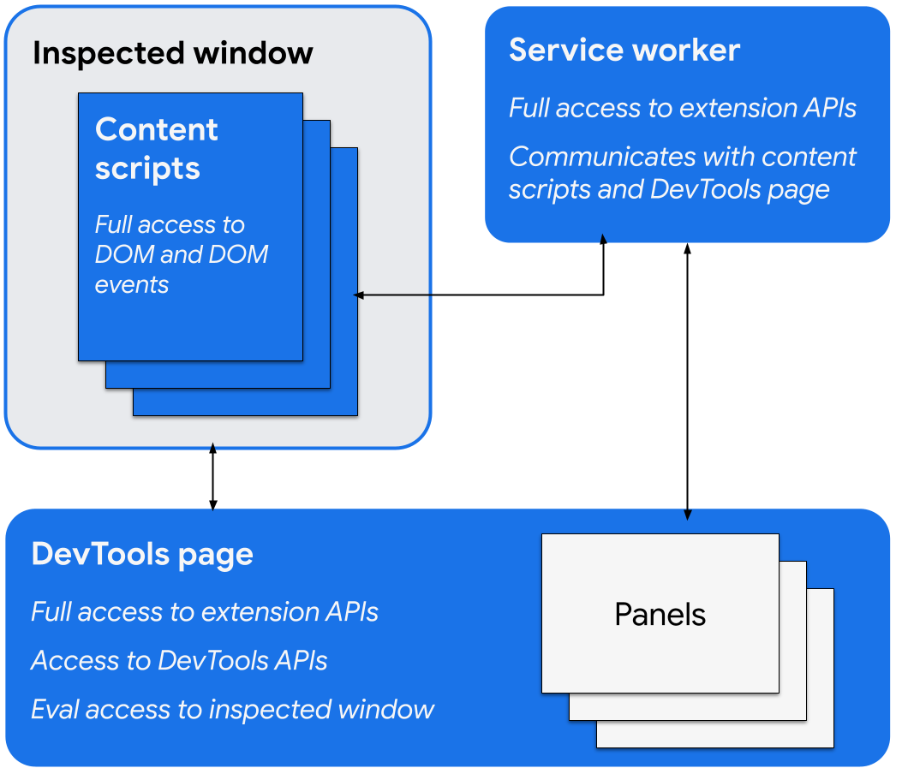

# Lexical DevTools browser extension

This is the source code for the Lexical DevTools browser extension.

[link-chrome]: https://chromewebstore.google.com/detail/lexical-developer-tools/kgljmdocanfjckcgfpcpdoklodllfdpc 'Version published on Chrome Web Store'
[link-firefox]: https://addons.mozilla.org/en-US/firefox/addon/lexical-developer-tools/ 'Version published on Mozilla Add-ons'
[link-safari]: https://apps.apple.com/us/app/lexical-developer-tools/id6502753400 'Version published on Mac App Store'

[][link-chrome] [][link-chrome]

[][link-firefox] [][link-firefox]

[][link-safari] [][link-safari]

## Local development

Lexical DevTools extension uses [WXT](https://wxt.dev/) framework to simplify development. Please refer to [WXT Development Guide](https://wxt.dev/guide/development.html) for comprehensive documentation.

**TLDR:**
```bash
$ pnpm run dev
# In browser: Alt+R to force reload extension
```

**Useful Hints:**
- Extension activity log: [chrome://extensions/?activity=eddfjidloofnnmloonifcjkpmfmlblab](chrome://extensions/?activity=eddfjidloofnnmloonifcjkpmfmlblab)
- Status of ServiceWorkers: [chrome://serviceworker-internals/?devtools](chrome://serviceworker-internals/?devtools)
- WXT Framework debugging: `DEBUG_WXT=1 pnpm run dev`
- If you detach the Dev Tools in a separate window, and press `Cmd+Option+I` while Dev Tools window is focused, you will invoke the Dev Tools for the Dev Tools window.

**Safari:**

To develop and run Safari version of the extension you (obviously) need a Mac and Xcode installed. Safari on the contrary to other browsers doesn't accept web extensions as a zip archive but rather requires you to [wrap it in native code (Swift) wrapper](https://developer.apple.com/documentation/safariservices/safari_web_extensions/converting_a_web_extension_for_safari/). Fortunately this process is mostly automated here.

```bash
# Install Xcode

# Environment setup
sudo xcode-select -s /Applications/Xcode.app
xcodebuild --install
sudo xcodebuild -license
xcodebuild -runFirstLaunch

# Normal operation
pnpm run dev:safari

# Build & upload to Apple Connect
BUILD_VERSION=0 pnpm run safari:archive 
PASSWORD="XXX" pnpm run safari:upload
```

## Publishing flow

**Preconditions:**

If new version of the extension contains big changes to it's UI or functionality, before proceeding, go to the web UI of every marketplace and update screenshots and preview videos.

**Chrome, Firefox:**

Go to the ["Publish DevTools extension to stores" GitHub action](https://github.com/facebook/lexical/actions/workflows/devtools-extension-publish.yml) and start it manually. Increase "Build version" in case publish happens more than once within single Lexical monorepo version.

**Safari:**

Automation is pending, pls contact vladlen_fedosov@epam.com

### Chrome Web Store API v2 setup

The publishing command explicitly selects API v2 and `DEFAULT_PUBLISH`: submit for review and publish after approval. WXT's locked `publish-browser-extension@6.1.1` already supports v2, so no replacement publisher or dependency upgrade is required. The workflow remains manual, runs only for the `facebook` repository owner, and serializes releases without cancelling an in-progress run. Chrome and Firefox submissions are independent; one can succeed while the other fails.

Before the first v2 release, a Chrome publisher administrator and the Google Cloud project owner must complete these steps manually. The marketplace contacts below are contact information, not confirmation of current ownership or access.

1. Confirm the publisher that owns the existing Lexical DevTools listing and the existing `EXTENSION_CHROME_EXTENSION_ID`. Obtain its **publisher ID** from **Publisher > Settings** in the [Developer Dashboard](https://chrome.google.com/webstore/devconsole); the publisher ID is different from the extension ID.
2. Enable the Chrome Web Store API in the intended Google Cloud project. Follow Google's [service account setup](https://developer.chrome.com/docs/webstore/service-accounts) to select or create a dedicated publishing service account. Google Cloud IAM access alone does not grant access to the store: a publisher administrator must link the service account email under **Account** in the Developer Dashboard. Google currently allows only one linked service account per publisher; confirm the existing configuration before changing it.
3. Provision a service account JSON key through the owner's approved credential process. Set the repository variables and secrets below in the repository that will actually run the release. Store the decoded `private_key` field as the private-key secret, including the PEM header/footer and actual newlines (decode JSON's `\n` escapes before saving). Do not store the entire JSON file in that secret or commit it to the repository.
4. Confirm the listing's existing visibility and rollout in the Developer Dashboard. API v2 preserves dashboard visibility and does not accept the old `default` / `trustedTesters` publish target. `DEFAULT_PUBLISH` controls when an approved revision is published, not its visibility. If visibility has changed, Google requires a manual publish with that visibility before API publishing can resume. This migration does not change visibility or rollout, cancel pending reviews, or skip review.
5. Confirm that the four-part manifest version exceeds the current store version. "Build version" is an integer suffix, not a complete version (for example, use `1`, not `0.52.0`). Wait for any previous Chrome submission to finish review before uploading another version.

| Repository setting | Kind | Publishing environment variable | Value |
| --- | --- | --- | --- |
| `EXTENSION_CHROME_EXTENSION_ID` | Existing secret | `CHROME_EXTENSION_ID` | Existing listing's extension ID |
| `EXTENSION_CHROME_PUBLISHER_ID` | New variable | `CHROME_PUBLISHER_ID` | Publisher ID from the Developer Dashboard |
| `EXTENSION_CHROME_SERVICE_ACCOUNT_CLIENT_EMAIL` | New variable | `CHROME_SERVICE_ACCOUNT_CLIENT_EMAIL` | Service account JSON's `client_email` |
| `EXTENSION_CHROME_SERVICE_ACCOUNT_PRIVATE_KEY` | New secret | `CHROME_SERVICE_ACCOUNT_PRIVATE_KEY` | Service account JSON's `private_key` only |

`EXTENSION_CHROME_CLIENT_ID`, `EXTENSION_CHROME_CLIENT_SECRET`, `EXTENSION_CHROME_REFRESH_TOKEN`, and `EXTENSION_CHROME_PUBLISH_TARGET` are no longer read by this workflow. No refresh-token regeneration is needed for this service-account path. Owners can assess retirement of the old secrets separately after the migration is verified. Firefox still uses the existing `EXTENSION_FIREFOX_EXTENSION_ID`, `EXTENSION_FIREFOX_JWT_ISSUER`, and `EXTENSION_FIREFOX_JWT_SECRET` secrets; Safari uses its existing flow.

The locked publisher has a small [pnpm patch](../../patches/publish-browser-extension@6.1.1.patch) registered in `pnpm-workspace.yaml` to handle asynchronous uploads. After an `IN_PROGRESS` response (also accepting the `UPLOAD_IN_PROGRESS` spelling used in Google's prose), it polls `fetchStatus.lastAsyncUploadState` every five seconds for up to five minutes. The timeout also aborts an in-flight status request. Only `SUCCEEDED` allows submission for review; failure, an unexpected state, a request error, or timeout fails the Chrome submission without uploading the ZIP again. Keep this exact-version patch when updating dependencies until the publisher provides equivalent bounded polling.

Offline reproductions and repository CI do not verify real credentials, publisher linkage, store review, or a live release. WXT's `submit --dry-run` **does contact Google to authenticate and fetch item status**; it is not an offline validation command. A permitted owner must perform that live access check separately before the first release. Do not dispatch the publishing workflow merely to check configuration: it uploads and submits to both stores.

References: [v1.1 migration deadline (October 15, 2026)](https://developer.chrome.com/blog/cws-api-v2#migration-timeline), [official API setup and visibility rules](https://developer.chrome.com/docs/webstore/using-api), [v2 publishing semantics](https://developer.chrome.com/docs/webstore/api/reference/rest/v2/publishers.items/publish), and [locked publishing tool's configuration reference](https://github.com/aklinker1/publish-browser-extension/blob/v6.1.1/docs/config-reference.md).

## Requesting maintainer access to extension marketplaces

At this moment all marketplaces are governed by [EPAM Open Source Office](https://www.epam.com/open-source) (contact [Vladlen Fedosov](mailto:vladlen_fedosov@epam.com) or [Christopher Howard](mailto:christopher_howard@epam.com)) and the access request flow is the following:

**Firefox:**

1. Create Mozilla account: https://accounts.firefox.com/settings
2. Enable two factor authentication for this account.
3. Go to https://addons.mozilla.org/en-US/firefox/users/edit and set a "Display Name" for your account.
4. Email to [Vladlen Fedosov](mailto:vladlen_fedosov@epam.com) and [Christopher Howard](mailto:christopher_howard@epam.com) with the request to add you as a maintainer to Firefox Add-Ons for Lexical Developer Tools extension. Pls include: Firefox account email; reasoning description.
5. _[For Maintainer]_ Open [authors & license management page](https://addons.mozilla.org/en-US/developers/addon/lexical-developer-tools/ownership) and add new user email.

**Chrome:**

A publisher administrator can grant access using the [current publisher ownership controls](https://developer.chrome.com/docs/webstore/share-ownership). Please reach out to the marketplace contacts listed above to identify the current administrator if you need access to the listing. This publishing workflow also requires the service account linkage described above. Use the publishing flow described above to release new versions.

**Safari:**

Apple limits App Store Connect member accounts to have the same domain names. So at this moment please reach out to [Vladlen Fedosov](mailto:vladlen_fedosov@epam.com) and [Christopher Howard](mailto:christopher_howard@epam.com) if you need to do any changes to the extension listing. New version publishing flow is automation is coming soon.

We consider creating new Apple Store Connect for `thelexical.onmicrosoft.com` AD, but it requires DUNS registered organization.

## Design

This extension follows typical [Browser DevTools architecture](https://developer.chrome.com/docs/extensions/how-to/devtools/extend-devtools) that includes sereral independent contexts that communicate via events or extension APIs.

<figure align="center">
  
  <figcaption>DevTools extension architecture.</figcaption>
</figure>
