# Yjs 14 (`@lexical/y`)

:::warning Experimental

`@lexical/y` is experimental: every export is marked `@experimental`, and
`@y/y` (Yjs 14) is itself a release candidate. Pin both versions. The
document layout carries a version, so a client that meets a newer layout
opens the document read only instead of misreading it.

:::

`@lexical/y` is a collaboration binding for Lexical on Yjs 14 (the `@y/y`
package). It is separate from `@lexical/yjs`, the Yjs 13 binding that the
[React guide](./react.md) uses: the two use different Yjs libraries and
different document layouts, and a document uses one or the other.

## When to use it

Use `@lexical/y` for a **new** collaborative editor that can run Yjs 14 on
every client and on its server:

- **Concurrent edits keep each other's text.** A paragraph, heading or list
  item is stored as its characters followed by a marker, and a link as a
  format over the characters it wraps. Splitting or joining a paragraph,
  changing its type, indenting a list item, or linking text keeps the
  characters, so what a collaborator types at the same time is not lost.
- **Smaller documents.** Enter, Backspace, heading and list changes write
  only a marker or its attributes.
- **No React or DOM requirement.** The binding is a Lexical extension, so it
  works with any framework and in a headless editor.

Stay on `@lexical/yjs` when you have documents stored in its layouts (see
[Moving from `@lexical/yjs`](#moving-from-lexicalyjs)), when your server or
other clients cannot move to Yjs 14, or when you need the
`LexicalCollaborationPlugin` React API.

## Install

```bash
npm i @lexical/y @lexical/extension lexical @y/y@14.0.0-rc.29
```

`@y/y` is a peer dependency pinned to the release candidate `@lexical/y` is
tested with; npm's `latest` tag points at an older one, so name the version.
The type declarations `@y/y` ships do not type-check on their own (an
upstream issue): if you run `tsc`, set `skipLibCheck: true`.

## Set up an editor

`YCollabExtension` connects an editor to a Yjs document. It also provides
collaborative undo (`UNDO_COMMAND` and `REDO_COMMAND` undo only this
client's changes), so leave out `HistoryExtension`: the two conflict. Any
Yjs 14 provider can carry the document; this example uses `@y/websocket`.

```ts
import {
  buildEditorFromExtensions,
  getExtensionDependencyFromEditor,
} from '@lexical/extension';
import {ListExtension} from '@lexical/list';
import {RichTextExtension} from '@lexical/rich-text';
import {createYDoc, YCollabExtension} from '@lexical/y';
import {WebsocketProvider} from '@y/websocket';
import {configExtension, defineExtension} from 'lexical';

const doc = createYDoc();

const editor = buildEditorFromExtensions(
  defineExtension({
    dependencies: [
      RichTextExtension,
      ListExtension,
      configExtension(YCollabExtension, {doc}),
    ],
    name: 'my-app/editor',
  }),
);
editor.setRootElement(document.getElementById('editor'));

const {binding, status} = getExtensionDependencyFromEditor(
  editor,
  YCollabExtension,
).output;

const provider = new WebsocketProvider('wss://example.com', 'my-room', doc);
provider.once('sync', () => {
  // Writes the editor's content if the document is new; otherwise the
  // editor shows the shared content.
  binding.initialize();
});
```

- Create the document with **`createYDoc`** (`createYDoc(stored)` for a
  stored state) and hand it to the provider: it turns Yjs's format cleanup
  off before anything is applied to it. In a plain `new Y.Doc()` the
  cleanup deletes format items the binding keeps for concurrent edits
  (already before the binding is attached, when a state is applied first),
  and that write reaches every client. So `doc` takes no other document,
  and the binding is read only on one that has the cleanup on (see
  [Warnings](#warnings)).
- The editor stays **read only** until the document's layout record has
  been read. `status` is a signal: `'pending'`, then `'active'`, or
  `'readonly'` when the binding cannot write the document safely (a newer
  layout, a node type this editor does not register, stored content its
  classes throw on; a [warning](#warnings) says why).
  Register the same node classes on every client. A read-only editor keeps
  showing the document: what a local update changes there (code that calls
  `editor.update()`, as the editor is not editable) is not written and is
  read again, with a warning (`UNSUPPORTED_EDIT_WARNING`). A binding that
  went read only to keep showing a change it cannot store (a slot, see
  [How content is stored](#how-content-is-stored)) leaves later updates as
  they are too.
- `binding.initialize()`, called after the provider's first sync, writes the
  editor's content into an empty document (an `editor.update()` still
  pending is part of it). Two clients that initialize the same content in a
  new document at once write it once, when they would write the same items
  (clients with different block id configurations write different ones, so
  the content shows twice). The editor then shows the content as stored, as
  every reader does (a line break written inside a text node shows as a
  line break node), with its selection kept (a node selection keeps its
  nodes, found by the Yjs identity they are stored or shown by: a node's
  item, a line's marker, a text node's first character, and for a list or
  a link the first of those inside it). It
  does nothing on a document that already has content, and it refuses a
  document whose `@lexical/yjs` roots hold content.
- The binding starts once the editor has its initial state
  (`$initialEditorState`, and what extensions write while they register),
  so that state is only ever the content of an empty document. On a
  document that has content (an editor built again on the same document, a
  document loaded from a cache before the editor), the editor shows the
  document and writes nothing. `binding.initialize()` called before the
  binding starts (from an extension's `register`) runs when it starts. An
  extension that depends on `YCollabExtension` and changes content in its
  own `afterRegistration` makes an edit, as an update made after
  `buildEditorFromExtensions` returns does.
- Pass `synced: true` instead when the document is already loaded (a test,
  an editor bound to a stored state, `createYDoc(stored)`): the extension
  initializes as soon as the binding starts.
- Several `editor.update()` calls made in one task are committed, written
  and sent together, as in any Lexical editor. Once the editor has
  committed in a task (an update an app's listener queues after a commit),
  an update that changes content commits at once, as with `discrete: true`,
  so that a remote change the provider applies in the same task finds no
  local update waiting to be written; so does one made while the binding
  has updates of its own waiting. A remote change a provider applies
  synchronously in the same task as updates made before any commit is
  integrated before them, and they are written after it, on the document as
  it was before that change, which they were made on: their edits land
  where they were made, and the change is read after them (providers that
  apply changes from network or channel events never do this).
- To seed or convert a document on a server, use `seedYState` (see
  [Server-side editing](./y-server.md)).

| Option | Default | |
| -- | -- | -- |
| `doc` | (required) | The Yjs document, from `createYDoc`. |
| `root` | `doc.get('lexical-y')` | The shared root to bind. |
| `synced` | `false` | Initialize as soon as the binding starts. |
| `captureTimeout` | `500` | Undo capture timeout in ms; `null` turns collaborative undo off. |
| `clientIDRange` | `'uint53'` | `'uint32'` for servers on yrs before 0.28, see [Servers](#servers). |
| `selfCheck` | `false` | Reads every local write (and every container a remote change rebuilt) back from Yjs and compares it with the editor; a mismatch is a `'@lexical/y/self-check'` [warning](#warnings). A debugging aid: turn it on in tests and development builds. |
| `selfCheckSample` | `1` | The fraction of changes the self-check samples: local writes, and remote changes (where a sampled check that finds the editor differing from the shared content also reads those containers again). |
| `convert` | `false` | Initialize even when a `@lexical/yjs` root has content. |

Only a client's own edits are written. A client that loads a document or
applies a collaborator's change writes nothing back. The binding's refresh
of list numbering, which runs after a client reads content and after its
own edits, runs the list classes' own transforms (not those an app
registers) and writes nothing: every client derives the same numbers from
the same document. The update Lexical makes when a transform is registered
while a document is open (it runs the transform over the whole document, as
a table plugin that pads ragged tables or recomputes column widths when it
mounts, or mounts again, does) is no one's edit either: it writes nothing,
and the binding reads what it changed again, so the editor keeps showing
what is stored; the author's next edit of that content makes the change, and
writes it. Wherever the transform is registered (inside an update, in a
listener, in a read), that update runs once the editor is idle, as an
update of its own, never committed with an edit; the transform itself is
registered at once, so an edit made before then runs it on what it changes,
and is written. Transforms registered in a row in one microtask (a plugin
host enabling plugins in a loop) share one such update; each microtask that
registers some makes its own (a host that awaits between plugins). A
listener that registers a transform after every commit makes a new one each
time. After 100 such updates before the event loop turns, the binding drops
the next ones with a development warning (Lexical caps updates that
listeners keep queuing the same way), so those transforms do not run over
the existing document. With [`BlockIdExtension`](/docs/extensions/block-ids), the blocks
a remote change brings without a unique id are named as they are read, from
the document (see [Block IDs](/docs/collaboration/block-ids)), so there is
nothing to name after a read. BlockIdExtension's naming update, when one
still follows a commit, may set attributes or delete. An element's text
format and style are stored where no text is below it (an empty paragraph,
one holding only inline decorators), and the naming update writes them
there as any update does; where text is below it, Lexical's reconciler
derives them on each client, and the naming update's change of them is not
written (read again). Anything else it changes is not written and is read
again (a development warning names the change). After the naming update is
written, the binding compares the part of each container it touched with
what a fresh reader shows for the document there, and reads that container
again where they differ, so that no shape the rules above miss leaves the
editor showing what is not stored. Every client's editor shows the
document: the binding reads remote changes without running transforms, and
a transform never rewrites what a client read.

`YCollabExtension` configures `BlockIdExtension` with
`repairTransforms: false`, so that its naming update sets ids and nothing
else. With `true` (the extension's default, which an editor that uses
`YBinding` directly gets unless it sets the option), the naming update would
also run transforms over what a remote change brought, and what they derive
(the start of a list they split) can disagree between clients, which would
then show different content. So the binding fails closed: when it finds
`repairTransforms: true`, it writes nothing, is read only and warns
(`@lexical/y/unsupported-config`). Set it to `false` there too. An update
another listener queues in the same listener phase as the naming update is
committed with it and counts as part of it: what it inserts is not written,
and the editor reads it back as stored.

A line that concurrent edits leave without its marker (text typed into a
paragraph a collaborator removed) has no stored id: every client derives the
same one from the document (the Yjs id of its first character), and the edit
that next changes the line stores it. A naming update that changes such a
line's content is not written, as only a marker (an insert) could keep it:
the editor reads it again. So does any block stored without an
id, or with an id an earlier block stores too (from its marker, its node (a
list stored as a node included), or for another list or a wrapper item, its
first item). Each list level owns its state: a list
that is not an identified block (a nested list, by default) keeps no block
id, nor one that a list it is inside holds, and when concurrent edits split
a list in two (both parts' items still carry its id), the second part reads
with an id derived from its first item. A list item that holds a nested list
derives one from that list's first item only where it is an identified block
(a root-only `$isIdentifiedBlock` identifies none), as the client that made
it shows. Every client reads these the same
way, and the next edit there stores them.

Without the extension API, `new YBinding(editor, doc, options)` does the
same: call `binding.start()` to connect it once the editor has its initial
state (an update made after it, on a document that has content, is an
edit), `binding.initialize()` after the first sync, and `binding.undo()` /
`binding.redo()` for undo. An undo puts back the selection from before the
step it undoes (as `HistoryExtension` does), and a redo the one from when it
was undone. Called while the editor
is updating (from a command handler, an update or its `$onUpdate`), it runs
right after that update commits, in an update of its own.
`binding.getCursor()` and `binding.$resolveCursor()` convert the selection
to and from Yjs relative positions for an awareness-based cursor UI; the
binding does not render remote cursors itself.

### Warnings

The binding reports to the editor's `onWarn` (set it on your root
extension, see [Errors and warnings](/docs/extensions/defining-extensions#errors-and-warnings)).
Each warning is a `LexicalWarning` with a stable `code` and typed `data`;
`isYWarning(error)` narrows it to the `YWarning` union, where `code` decides
the type of `data`, and `data.reason` says which case it is. The `message` is
a short note for developers: render your own text from `code` and `data`.

| Constant | Reported when | `data` (`reason`: other fields) |
| -- | -- | -- |
| `UNSUPPORTED_LAYOUT_WARNING` | The layout is one this version cannot read. Read only. | `'newer'`: `found`; `'malformed'`: `key`, `found`; `'missing'`, `'removed'`; `'legacy-roots'`: `roots`. All: `supported` |
| `UNKNOWN_NODE_TYPES_WARNING` | The document has node types the editor cannot build: types it does not register, however they are stored (a link class it lacks too), or content its classes throw on. Read only. | `'unregistered'`, `'malformed-slot'`: `types`; `'unreadable'`: `types`, `error` |
| `STORAGE_MISMATCH_WARNING` | A node type is stored in a way its class cannot be (one warning per type). Read only. | `'declaration-changed'`: `type`, `stored`, `declared`; `'malformed'`: `type`, `key`, `found` |
| `UNSUPPORTED_SLOTS_WARNING` | Named slots where the document cannot store them. Not written; read only. | `'stored-host'`, `'root'`: `types` |
| `UNSUPPORTED_CONFIG_WARNING` | `BlockIdExtension` with `repairTransforms: true`, or a document with Yjs's format cleanup on (not from `createYDoc`), see [Set up an editor](#set-up-an-editor). Nothing is written; read only. | `'repair-transforms'`: `options`; `'cleanup-formatting'` |
| `NESTED_FALLBACK_WARNING` | A class that declares a line, format or group is stored as a node of its own (see [How content is stored](#how-content-is-stored)). Once per binding, class and reason. | `type`, and `method` (`'merge-override'`) or `properties` (`'undeclared-properties'`) |
| `UNSYNCED_VALUE_WARNING` | A property or NodeState value is not plain JSON, so it is not synchronized. Once per binding and property. | `'not-json'`: `property` |
| `UNSUPPORTED_EDIT_WARNING` | A local update changed the editor while the binding is read only. Not written; what it changed is read again. | `'read-only'` |
| `SELF_CHECK_WARNING` | The self-check (`selfCheck`) found the editor and the document disagree. | `'local'`, `'remote'`: `problems` |
| `RECOVERED_READ_WARNING` | A change could not be read; the editor was rebuilt from the document. | `'remote-change'`, `'reread'`: `error` |
| `RECOVERED_WRITE_WARNING` | A local change could not be written; the document was rewritten. | `'local-change'`: `error` |

A read-only banner of your own, from the fields:

```ts
import {isYWarning, UNSUPPORTED_LAYOUT_WARNING, type YWarning} from '@lexical/y';

function banner(warning: YWarning): string | null {
  switch (warning.code) {
    case UNSUPPORTED_LAYOUT_WARNING:
      return warning.data.reason === 'newer'
        ? t('doc.needsNewerApp')
        : t('doc.cannotOpen');
    // ...
    default:
      return null;
  }
}

defineExtension({
  // ...
  onWarn(error) {
    if (isYWarning(error)) {
      showBanner(banner(error));
      log(error.code, error.data);
    } else {
      console.warn(error);
    }
  },
});
```

- Warnings arrive once a change has been applied in full: never from inside
  a Yjs observer or transaction. A handler that throws does not affect
  syncing; its error is rethrown in a microtask.
- Without a handler, Lexical's default `onWarn` applies: it throws in
  development (each warning shows up as an uncaught error) and calls
  `console.warn` in production.
- Codes are never renamed or reused; new ones may be added. A `default`
  that assigns the warning to `never` makes the compiler point at a code
  your `switch` does not handle.

## How content is stored

`@lexical/y` does not copy the Lexical tree node for node. Each container
(the root, a table cell, a collapsible's content) is one Yjs sequence of
characters, `¶` markers and nested nodes. Splitting a paragraph, changing its
type or linking a word then only writes a marker or an attribute, and the
characters a collaborator is typing into stay where they are. Three rules
decide how a node is stored.

**1. A block that holds text is its text followed by a `¶` marker.** The
marker carries the block's type, fields and NodeState; text formats are
attributes of the characters.

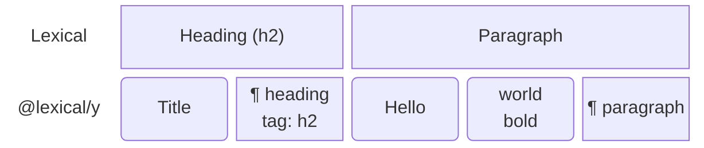

_The heading and the paragraph above, as one sequence._

**2. Lists and links have no node of their own.** A list is rebuilt from its
items, whose markers carry the list's type and the item's level, and a link
is an attribute over the characters it wraps.

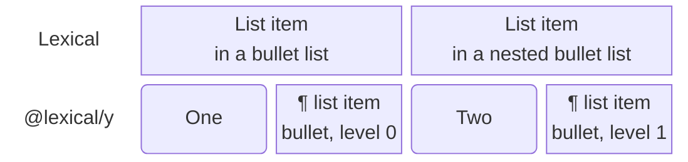

_A nested list: the second item's marker says level 1._

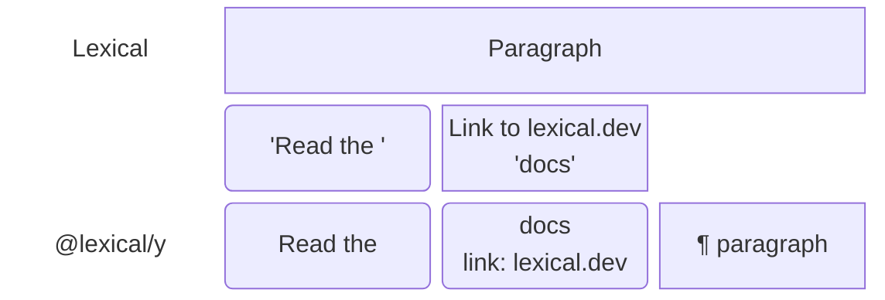

_A link: the characters carry its URL._

**3. Everything else is a node of its own**, with its fields as attributes:
tables, rows and cells, decorators, custom containers. An element holds its
own sequence.

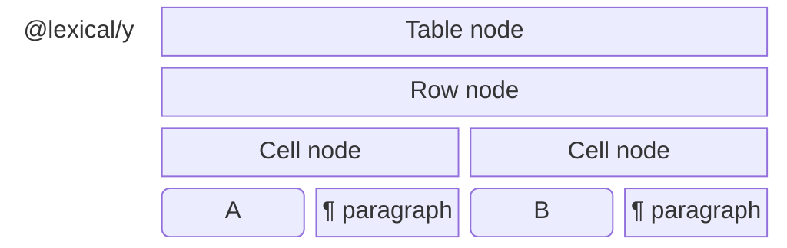

_A table: the table, its rows and its cells are nodes of their own, and each
cell holds a sequence._

**Named slots go with the node that holds them.** A block decorator or
custom container that holds content in [named slots](/docs/concepts/named-slots)
(`$setSlot`, as a callout's body or a figure's caption) keeps each slot on
its own node, under the slot's name. The slot's node is a node of its own
too, holding its content as a sequence (a slot that holds one paragraph holds
its text), so collaborators typing in one slot merge as in any container.

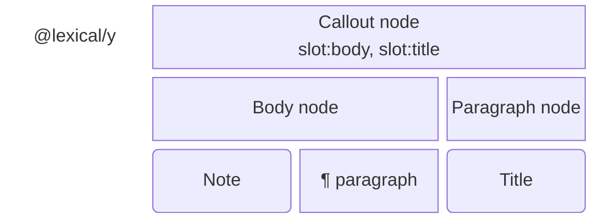

_A callout with two slots: its body holds a paragraph, its title one line._

Only a node of its own can hold slots: a slot set on a paragraph, heading or
list item (stored as a marker), a link (a format) or a list (rebuilt from its
items) cannot be stored, so the binding writes nothing of that change, warns
(`@lexical/y/unsupported-slots`) and goes read only rather than drop it. A
class that declares `slots` in `$config()` is always stored as a node of its
own.

Custom nodes follow the same rules, from the
[node structure](/docs/serialization/#node-structure) their class declares: a
block that declares `children: 'inline'` is stored like a paragraph, an
inline element that declares `inline: true` and `mergeAdjacent` like a link,
and anything else as a node of its own. Properties a class keeps outside its
`$config` schema and NodeState are not synchronized; for a class that
declares a line, a format or a group, the binding warns about such
properties on its instances and stores it as a node of its own.
`describeStorage(editor)` lists how each node type is stored. The first write
of a type records its kind, so a later client whose class declares something
else keeps the recorded kind or opens read only. The stored names are
specified in the
[package README](https://github.com/meta/lexical/tree/main/packages/lexical-y#wire-format-layout-1).

## Wire format

The diagrams below use the stored names. The package README specifies them
exactly:
[layout 1](https://github.com/meta/lexical/tree/main/packages/lexical-y#wire-format-layout-1).

**Layout 1.** A container's sequence holds characters, `¶` markers and
nodes of their own. A marker holds the line's type in `t` (left out for a
paragraph), its fields as `p:<field>` and its NodeState as `s:<key>`. Text
formats are ranges over the characters: `f:<format>` for a text format, and
`w:<type>` for an inline element stored as a format, such as a link. A node
of its own is a `b:<type>` child that holds its own sequence (`c: b` when it
holds blocks), and each of its named slots as an attribute `slot:<name>`
whose value is the slot's `b:<type>` node. The root also records the layout
versions the document needs
(`lexical-y:1`, a record that only grows) and, per type, the storage kind its
first write chose (`k:<type>`).

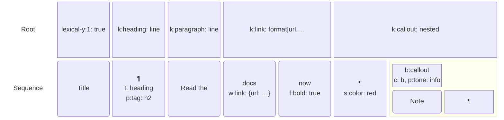

_A heading, a paragraph with a link, a bold word and a NodeState value, and
a custom container (`callout`) that holds a paragraph, in layout 1._

## What changes when you turn on collaboration

Because a paragraph, heading or list item is stored as text followed by a
marker, it can only hold inline content: text, line breaks, links and inline
decorators. Stock Lexical does not stop a block from ending up inside one, so
`YCollabExtension` adds
[`NodeStructureExtension`](/docs/serialization/#node-structure), which
rewrites such shapes into ones the binding can store. The client whose edit
makes such a shape rewrites it in that edit (or, for an update that ran
without transforms, right after it), and the rewrite only moves content:
nothing is deleted. In the diagrams below, a box holds the boxes under it.

**A block inside a paragraph is split around**, so the block keeps its type.
The same holds for a heading, code block, nested quote or table inside a
quote or list item.

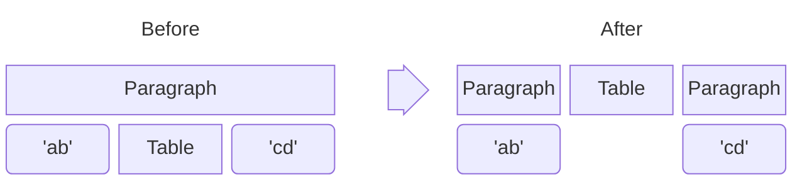

**A heading inside a link becomes a heading holding the link.**

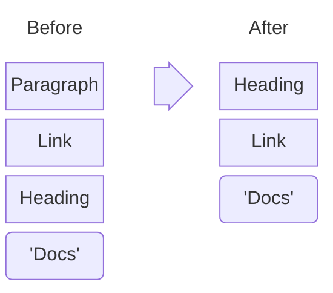

**Paragraphs inside a quote become lines of one quote**, joined by line
breaks, as HTML's `<li><p>a</p><p>b</p></li>` already imports. Paragraphs
inside a list item become lines of the item the same way.

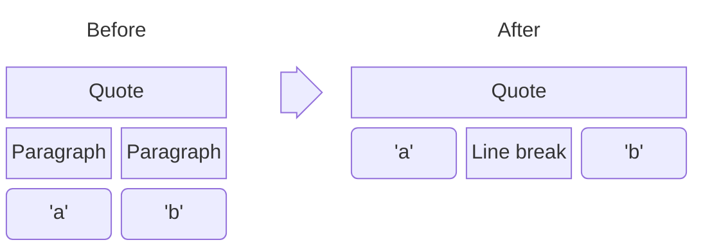

**A block decorator inside a list item splits the list**, as inserting a
horizontal rule into a list item does. In a numbered list, the numbering
continues: the second list starts where the first one stopped (an item that
held only the rule goes, and the next item takes its number).

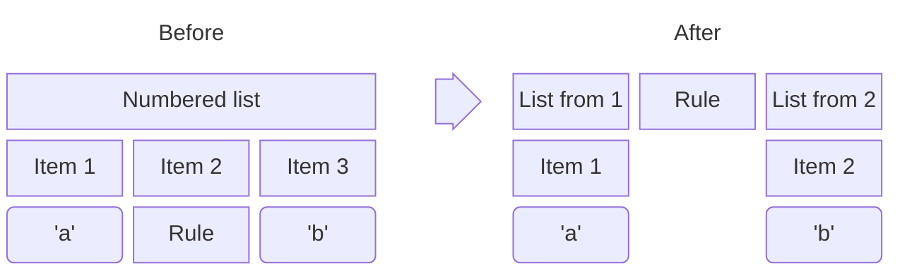

**Adjacent equal links merge** (same URL, target, rel and title), and so do
adjacent lists of the same type. Inline content directly in the root or in a
table cell (text, a link, a mark) is wrapped in a paragraph.

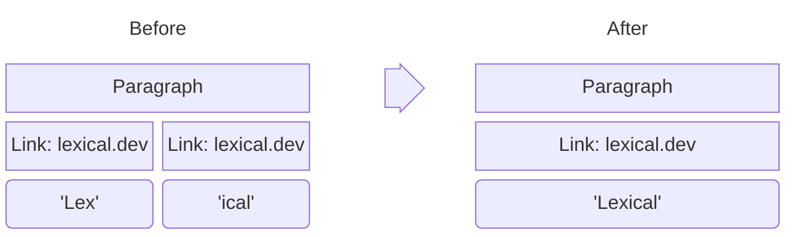

What this means for your app:

- **Where these shapes come from:** pasted or imported HTML, documents saved
  by an editor without the extension, app code that inserts a block into a
  paragraph, and concurrent edits. The client whose edit makes such a shape
  rewrites it in that edit (or, for an update without transforms, right
  after it). Shapes left by concurrent edits are shown as stored until a
  local edit touches them (see [Limits](#limits)).
- **Only editors with the extension are affected.** Editors without
  `@lexical/y` (or `NodeStructureExtension`) keep these shapes. Shadow
  roots, `OverflowNode` and classes that declare nothing are never rewritten.
- **Some content looks different afterwards.** A quote or list item that
  held paragraphs shows them as lines of one quote or item, a heading or
  code block inside a quote is moved out of it, and a list around a
  horizontal rule becomes two lists, the second numbered on from the first.
  A line feed inside a text node (`setTextContent('a\nb')` from code), of
  any mode (token and segmented text too) or class (a code highlight), is
  stored, and shown on every client, as a line break: the author's text node
  is split into text and line break nodes in the same edit (in its
  normalization, for an update with `skipTransforms`). The parts keep the
  node's format and NodeState; the first keeps its class and mode, the others
  are plain text nodes (as Lexical's `splitText` makes them, so a segmented
  node's parts all are). Each line break keeps the NodeState its line feed
  had (a comment on just the line feed stays). An array property with an
  undefined entry (a table's `colWidths` after a column is inserted past the
  stored widths) is stored with `null` there, which every reader parses as
  the class does (`TableNode`: `0`, as its own JSON round trip gives); the
  author's normalization gives its node that value too, and writes it.
- **To keep blocks inside a container, make it hold blocks.** Declare
  `children: 'block'` on a custom container (a callout that holds
  paragraphs; stray text in it is then wrapped in a paragraph), or use a
  shadow-root quote, `$createQuoteNode({shadowRoot: true})`, which holds
  paragraphs and is left alone.

## Edits made by code (agents, tools)

Code that edits a document on someone's behalf (an agent, an import, a
formatter) merges with collaborators best when its edits look like a
person's:

- **Edit text in place** (insert and delete characters in a text node)
  rather than replacing blocks or whole documents. A replaced block is a
  delete and an insert, so what collaborators type into it at the same time
  is lost (see [Limits](#limits)). Lexical records the text edits of an
  update while the binding is attached: `TextNode#spliceText`, the
  selection's `insertText` and `removeText` (and the commands built on
  them), splits and merges of text nodes, text typed into a node Lexical
  makes for it, and every node inserted into or removed from a line. The
  binding writes typed and deleted text exactly where it was typed or
  deleted, with or without a caret, and several such edits in one update
  each where it was made: an insert next to equal text (`t5z ` typed
  before `t4z `) or a delete of one of two equal runs keeps every other
  character, so a collaborator's concurrent edit of them stays where it was
  made, and a replacement is written as made. Every other change is placed
  by where it is in the line, not by the node that holds the text (in
  storage a node's type, format and link are attributes of its
  characters): wherever the line's text is unchanged, nodes removed and
  made again, replaced, split, merged, wrapped in a link or unwrapped keep
  their characters (the hashtag plugin, a keyword highlighter or another
  transform making a part of a node again, an entity grown over the word
  after it, two entities made plain text at once), also when the update
  then edits them; text made where the line's text changed (a node with
  other text, a line break, an inline node) is new where it is put. Prefer
  these to `setTextContent`, which sets a node's text whole: such a change
  (and a change the browser makes to the DOM text, as an IME composition
  does) keeps the start and end its text shares with the node's old text,
  anchored at the caret, which cannot tell where an edit next to equal text
  was made without one; a replacement found that way replaces whole words
  (what a collaborator types inside the replaced words at the same time
  lands in one piece at the start of the new text, and the letters the new
  text shares are written again, so a collaborator's formatting of them at
  the same time is not kept), except in an IME composition, a replacement
  that adds or removes an inline node, and text in scripts written without
  spaces (Chinese, Japanese, Thai). The rest of the line is written
  exactly. Text moved into a node stored on its own (an autolink, see
  [Limits](#limits)) is written there anew. No write splits a surrogate
  pair: an edit next to one half of an emoji writes the whole pair again.
  Two inserts at one position at once (an agent inserting at the start of
  a line while a person types there) each stay whole, in the order Yjs
  gives them (by client id), the same on every client.
- **Skip remote changes in listeners that edit.** An app listener that
  changes the document after every update (a character limit that wraps
  the overflow, an auto-formatter) should skip updates tagged
  `COLLABORATION_TAG`: otherwise every client that reads a change makes the
  edit again, and each client's copy of it is kept. The binding tags every
  update it makes itself with `COLLABORATION_TAG`: its reads of remote
  changes, the reads that put back what a follow-up may not write, and its
  refresh of derived list fields (numbering), also on open. So the tag
  tells apart users' own edits, which a listener may act on, from
  everything else. (Lexical's update that runs a newly registered transform
  over the document keeps Lexical's tags; it writes nothing.)
- **Apply an edit to the state it was computed from, then merge.** An edit
  planned from an older read (a model's answer arrives seconds later) can
  land in the wrong place if it is applied to the current state. Load that
  read's update into a document (`createYDoc(readState)`), bind a headless
  editor to it with `YBinding`, apply the edit there, and apply the update
  it produced
  (`Y.encodeStateAsUpdate(copy, readStateVector)`) to the live document:
  Yjs merges it with what changed since. The copy's writes go into the live
  document, so give its `YBinding` the same `clientIDRange` as the other
  clients (see [Servers](#servers)).

On a server, `editYState` from `@lexical/y/headless` does the second step:
run it on the state the edit was computed from, with the agent's writer, and
merge the `update` it returns into the live document (see
[Edits by agents and tools](./y-server.md#edits-by-agents-and-tools)).

## Servers

Any Yjs 14 server or relay can host the documents. Clients of
`@lexical/yjs` write to other roots (`root`, `root-v2`), never to
`DEFAULT_ROOT_NAME` (`'lexical-y'`), so they cannot change a `@lexical/y`
document's content and the server needs no check to keep them out.
To seed, edit or read documents on the server, see
[Server-side editing](./y-server.md).

A server or relay that loads a document into a Yjs `Doc` and stores its
state must turn off Yjs's format cleanup on that document before it applies
updates, as the clients do. `createYDoc` (from `@lexical/y`, or
`@lexical/y/headless`) makes such a document, with the stored state applied:

```ts
import {createYDoc} from '@lexical/y/headless';

const doc = createYDoc(stored);
```

A relay that cannot import it sets the flag on a new document itself
(`doc.cleanupFormatting = false`).

Otherwise, when Yjs applies an update there it deletes format items that
it finds redundant but the clients keep, and the state the server stores
reads differently from what the clients show.

Servers built on **yrs before 0.28** (y-crdt) read client ids as 32-bit
numbers, while Yjs 14 draws 53-bit ones: an author can receive its own
content back as another client's on reconnect (duplicating it), or lose
offline edits. For such a server, pass `clientIDRange: 'uint32'` on every
client of the document and in the server's `@lexical/y/headless` config. Give the document a 32-bit client id
before you create the awareness and the provider, because an awareness takes
the document's client id when it is created:

```ts
doc.clientID = crypto.getRandomValues(new Uint32Array(1))[0] || 1;
```

Deliver each client's updates in order. With Yjs 14.0.0-rc.29, a client
that receives an update past a gap in another client's clocks (a relay that
reorders and batches updates) can show a character that a document loaded
from that client's own `encodeStateAsUpdate` keeps pending, until the
missing updates arrive: a reload from such a stored state, or a server that
compares re-encoded states, can briefly differ from the live client. This
is in Yjs, not the binding (which shows what its document holds).

Also with Yjs 14.0.0-rc.29, a client's document can emit an update that
cannot be decoded ([yjs/yjs#825](https://github.com/yjs/yjs/issues/825);
a fix is proposed in [yjs/yjs#826](https://github.com/yjs/yjs/pull/826)):
every peer fails to apply it, and that client's own `encodeStateAsUpdate`
throws from then on, so a provider can no longer sync or store its state.
It reproduces with Yjs alone (a long soak session hit it once). Reload such
a client from the server's state; a Yjs release that includes the fix
avoids it.

Use **yrs 0.26 or later**. yrs 0.23.4 through 0.25.0 can drop part of a
reconnecting client's delete set when a deleted range starts on a block the
server has already garbage collected: the server keeps content that client
deleted while its changes did not reach the server (offline, a dropped
connection, a reload from local storage), and that client then differs from
everyone else for good, with no warning. 32-bit client ids do not prevent
it; yrs 0.26.0 fixed it. Before 0.28, the 32-bit client ids above are still
needed.

## Limits

Every client converges to the same document, but some concurrent edits do
not merge as a user might expect:

- **Moves.** Moving a block is a delete and a re-insert, so text a
  collaborator types into the moved block at the same time is lost or lands
  at its old position, a collaborator's caret in it stays at that position,
  and two collaborators moving the same block at once can duplicate it.
  Undoing the move restores the block as it was before the move: what
  collaborators typed in it since is lost or, in a moved line, stays where
  the moved copy was. The moved block is the node Lexical recorded as moved:
  an existing node passed to `insertBefore`, `insertAfter`, `append` or
  `splice` in the update (as a block drag does), even one put back where it
  was. The blocks it passes that Lexical did not record keep what
  collaborators type in them. Between recorded blocks, and in a reorder that
  Lexical did not record (an editor state set whole), the binding rewrites
  as few blocks as it can, the smaller ones on a tie.
  Lexical operations that move content (turning a
  paragraph into a list inside a container, indenting list items that hold
  blocks) behave the same way, and so does the first edit that restructures
  a list stored in an older shape (a nested list kept as a node inside an
  item's line): its items move into the list's own sequence. A Backspace
  that outdents an item of such a list is a delete in the nested list's
  container and an insert in the list's: text a collaborator types in those
  items at the same time is lost (only lists stored in that older shape).
- **Delete wins.** Text typed into a container that a collaborator deletes at
  the same time is deleted with it, and so is a block moved into it.
- **Last writer wins** for the fields of one link (URL and target change
  together) and for a field of one paragraph or list item.
- **Inline elements with their own content.** `MarkNode`, and a link class
  stored as a node of its own (`AutoLinkNode`, whose adjacent links never
  merge, see [Warnings](#warnings)), are elements with their own content, so
  wrapping a range (an autolink made as its last character is typed) moves
  the text into it, written there anew: concurrent typing in that range
  stays outside, and a collaborator's concurrent delete of a character there
  does not apply to the moved text. Store comments as NodeState instead,
  with [`MarkStateExtension`](./comments.md).
- **Input method composition.** While the editor composes with an input
  method (IME) in a line, what collaborators add to that line (text,
  formats and comments, a split, pasted lines, a change of its type) waits
  until the composition ends, and the line keeps its nodes, so the browser's
  composition is not disturbed. Then all of it shows where it is, also after
  Enter or a paste made while composing. What removes something from the
  line (a deletion, a join, a `MarkNode` comment, which moves the text into
  it) shows at once: the text node being composed keeps its key, unless its
  class changes (a code block made a heading).
- **Set-valued NodeState** (`arraySetValue`, which `MarkStateExtension` uses)
  merges per member on text, line breaks and nodes stored as their own Yjs
  node (such as decorators), so two collaborators commenting on the same
  words both keep their comment. On a line such as a paragraph or heading, a
  list item, a list or a link the set is one value, and concurrent changes
  to it keep one writer's set. The state needs no registration: a client
  that has not used it yet holds the members as one unknown value, which
  its first `$getState` reads, and writes them back one per member. Do not
  name another state with a set's key followed by U+001F (`'tags\u001fx'`
  next to a set `'tags'`): that is the name the binding stores the set's
  member `x` under, so it refuses such a state, even one without a value,
  whenever it writes it or the set. Storing members this way is layout 2:
  the first member a client stores in a room records it, and from then on
  clients of an earlier `@lexical/y` (layout 1 only) open that room read
  only (see [Changing the layout](#changing-the-layout-and-migrating)).
- **Removed set members.** Removing a member from text that stores its set
  per member (resolving a comment with `$removeMarkID`) leaves one small
  live format item after that text (about 30 bytes with a short comment id),
  which the binding cannot safely clean up: a collaborator writing inside
  that text at the same time may still rely on it. So the document grows
  with every member removed, not only with its content. Removing the same
  member again at the same place adds nothing, and adding a member and
  undoing it leaves nothing. For comments, keep resolved ids in the text and
  mark the threads resolved in your own store instead (see
  [Resolving comments](./comments.md#resolving-comments)).
- **Named slots.** A slot holds one node: two collaborators setting the same
  slot at once keep one writer's node, and text typed in a slot that a
  collaborator replaces or removes at the same time is lost (as with delete
  wins). Moving a block rewrites its slots with it (see Moves). Slots on a
  node stored as a line, a format or a group, or on the root, are not stored
  (see [Warnings](#warnings)).
- **Not synchronized:** nested editor instances (their JSON snapshots are),
  and properties outside a class's `$config` schema and NodeState.
- **Shapes concurrent edits leave are shown as stored.** No client repairs
  them; the next local edit that touches one changes it, as that client's
  own edit.
  - A table whose rows end up with different lengths (a row insert ‖ a
    column insert: the new row lacks the new column) stays so until the next
    table command, which pads it. Two clients running a table command on it
    at once both pad it, and the table gets an extra empty column. A table
    plugin that mounts (or mounts again) once the document is open pads
    nothing and recomputes no column widths: the update in which Lexical
    runs a newly registered transform over the document writes nothing, and
    the editor reads what it changed again.
  - A list item that holds its nested list next to other content (text, a
    second list) stays so until a local edit changes that item (its
    children, or the item itself; typing in its text does not). Lexical's
    commands, its paste and `NodeStructureExtension`, which every
    `@lexical/y` editor runs, give a nested list an item of its own; only
    writers without that normalization store this shape.
- **Content written without Lexical's normalization** (an update with
  `skipTransforms`, or `setEditorState` with a state the editor did not
  build) is normalized by its author right after, as part of the same edit
  (the same undo step, as the undo manager groups transactions made within
  `captureTimeout`: with `captureTimeout: 0` the normalization is an undo
  step of its own, and one undo leaves the content as written);
  other clients show it as written until that arrives, and an author that
  goes offline in between leaves it so until someone edits there. Writes
  with `skipTransforms` bypass the normalization when they are written, so
  they can store shapes the binding handles less well; prefer updates that
  run transforms. A Lexical
  command used on such a shape before the normalization arrives can fail
  (Shift+Enter in a list item that holds only a block decorator throws).
- **A line without a marker.** Text typed into the last block of a
  container while a collaborator removes that block is kept, as a line
  without its marker (shown as a paragraph). Other edits in that container
  leave it so; two clients that type into it at once each give it a marker,
  which splits it in two (one part can be empty).
- **List type change ‖ new item.** Changing a list's type while a
  collaborator adds an item to it (Enter in the list) splits the list: the
  new item keeps the old type, in a list of its own between the two halves.
- **Blocks that arrive without an id.** With `BlockIdExtension`, a block
  stored without an id (written by a client without the extension), or with
  an id an earlier block also stores or shows (a copy of the JSON of a block
  as a reader showed it, whatever id it showed), shows an id derived from
  its Yjs identity until a local edit of it stores that id (see
  [Block IDs](/docs/collaboration/block-ids)). Such an id changes when the
  block's identity does: a list's derived id comes from its first item, so
  an item added before it gives the list another id (a list stored as a
  node, inside a line, derives its own from its node). Blocks inside named
  slots that repeat an id are renamed by `BlockIdExtension` instead, and
  every client writes those names; in rare histories a fresh reader then
  shows another id for a slot's root block than the clients do.
- **Mixed block id configurations.** Clients that write with and without
  `BlockIdExtension` (or with another `$isIdentifiedBlock`) are supported
  but discouraged: each shows what a client of its own configuration that
  opens the document shows, but the ids differ between configurations (no
  id or a repeated stored id where clients with the extension show a
  derived one; a list that is not an identified block shows its stored id
  only without the extension, while other blocks there keep it everywhere;
  see [Block IDs](/docs/collaboration/block-ids)).
- **Lone surrogates.** Text holding a lone surrogate (malformed UTF-16,
  which code can produce by splitting a surrogate pair) reaches every other
  client as U+FFFD, as Yjs encodes text as UTF-8; its author keeps it until
  it reloads. Yjs 13 does the same.
- **Initial content with random values.** Clients that initialize a new
  document at once write it once only when their content is identical. An
  extension that gives new blocks random ids makes it differ, so the content
  shows twice; so do different block id configurations (with and without
  `BlockIdExtension`, or another `$isIdentifiedBlock`), initializing a root
  that held content before, and initializing a root inside another shared
  type. Seed new documents in one place (on the server with `seedYState`, for
  example), or give the initial blocks fixed ids.
- **Client ids add up.** A document keeps every client id that ever wrote
  to it, in its state vector (which every sync sends) and in the
  bookkeeping Yjs does each time it loads the document. A browser tab writes
  under one while it is open; an editor bound to a new `Y.Doc` for each task
  (an agent's copy, a script) adds one each time. On a server, give
  `editYState` a writer from `createYWriter`, which keeps one client id per
  document; with `writer: null`, each edit adds one (see
  [Writers](./y-server.md#writers)).
- **Undo** keeps a container whole once another client has put content in
  it. Undoing a removal restores the text as new content: a block a
  collaborator moved out of the removed range at the same time shows twice
  (the original next to the moved copy), and when two
  collaborators remove the same text and both undo, it shows twice.
  Undoing a format change does not undo a collaborator's later change of
  part of its range, nor the value that change restored after itself: color
  `abc`, let a collaborator recolor `b`, then undo the color, and `c` keeps
  the old color, up to the end of the range (the same holds for text a
  collaborator types or pastes inside the range as you undo). Undoing a link
  while a collaborator formats text inside it keeps the link on its text:
  formatting text in a link also sets the link's text format, which writes
  the link there again. Where a collaborator overwrote a step of yours
  entirely, the undo manager skips that step as changing nothing, and the
  same undo also reverts your step before it. When you undo a format change
  while a collaborator removes that format and undoes the removal, the text
  keeps the format: the collaborator's undo brings it back.
- **Large lists.** A structural edit in a list costs time proportional to
  the list on every client.
- **Older app versions.** A client keeps the fields, text formats and
  NodeState it does not know when it edits a node (see
  [Changing your own node types](#changing-the-layout-and-migrating)), and
  in a block it moves, which is written anew (see Moves): the new copy takes
  what the block stored, and an item that joins another group takes that
  group's fields. A line it splits keeps a field it does not know on both
  lines (the empty line Enter makes at the end of a line excepted): it
  cannot tell whether the newer class copies the field to the new line, and
  keeping it on both loses nothing. The text of a moved block is written
  anew from what the client shows, so it loses the text formats it does not
  know, and the fields of a text class or a link that the client's classes
  do not declare.
  A nested list whose item it moves into another list does not take the
  fields of that list it does not know, so where that item becomes the
  list's first, every client reads the list without them.
  A link it replaces with another link of the same type over
  the same text keeps the ones of the link it replaced: it cannot tell the
  new link from the old one edited. A class that writes its own `exportJSON`
  owns every field of its type, since which ones it writes cannot be known:
  an older version of it deletes the fields a newer one added. Declare fields
  in `$config` to keep them.
- **The caret when a collaborator rewrites its line.** A caret stays after
  the text it was after. When a collaborator replaces the line holding it,
  deleting all the line showed and putting new content at its place in one
  change (an agent's block-level write, a paste over the line), the caret
  keeps its offset in the new line, clamped to its end (in the first line,
  where several take its place); where any character of the line is kept,
  it stays after the same text. A line removed with no line put at its
  place (or replaced by a block node) sends it to the start of the line
  after, or to the end of the line before where a block node follows,
  never onto the block node.
- **NodeState key order.** Other clients (and any later reader) get a node's
  NodeState with its keys in sorted order, which every client builds the
  same way, not in the order the author's editor exported them (a Yjs map
  does not keep one). Compare node JSON without relying on key order.
- **Other races.** A split racing a change of the line's type gives the
  first half the splitter's type. Bold ‖ bold on adjacent ranges of one line
  can leave part unformatted. A format removed from a range while a
  collaborator types inside it without that format (unbolding a word as
  they type into it, resolving a comment as they paste into it) comes back
  on the part of the range after their text: their write restores the
  format they saw there, which the removal could not see. It stops at the
  end of the range. Text typed inside or at the edge of text a
  collaborator deletes at the same time keeps the formats it was typed
  with; text typed at the start of a range a collaborator formats at the
  same time can take that format, by the order Yjs gives the two inserts
  (the same on Yjs 13), and keeps it when that range is then deleted. A
  node whose `isInline()` changes is written again in its new form, so
  text typed inside it at the same time lands next to it, in an inline
  element of its old form. Where text was deleted, the format items it
  leaves are kept, so that a collaborator's concurrent edit inside or at
  the deleted text keeps its formats, until a later delete at the same
  place keeps a few per format key of them; text a collaborator types
  inside the earlier deleted text after that, where its format changed
  more than once along it, takes the format that text had at its start,
  and so does that text where an undo brings it back after another
  collaborator's delete there. Two joins at once into the same line both
  write its type, and Yjs keeps one of them by client id: a heading joined
  across a quote to the paragraph after it, while a collaborator joins that
  paragraph into the quote, can become a quote.

## Changing the layout and migrating

The [wire format](https://github.com/meta/lexical/tree/main/packages/lexical-y#wire-format-layout-1)
in the package README is the contract for what a room stores: the markers,
attributes and records, and their names. Every room records the layout
versions it needs (`lexical-y:<n>: true`, a record that only grows;
`LAYOUT_VERSION` is currently 2), and a client reads the highest. A new
room records layout 1; the first member of a set-valued NodeState stored
per member (see the limits above) records layout 2, so rooms that never
hold one stay readable and editable by layout 1 clients.

- **Changes that keep the layout:** additions older clients can ignore, such
  as a new optional attribute. Rooms keep working in old and new clients.
- **Changes that bump `LAYOUT_VERSION`:** anything older clients would
  misread. A newer `@lexical/y` reads every older layout and adds the new
  version to a room's record only when it first writes something that needs
  it, in the same transaction; from then on, older clients open that room
  read only. Upgrade every client of a room together.
- **Changing your own node types:** fields are stored by name, so adding a
  field with a default, or dropping one, works as in
  [Lexical JSON](/docs/serialization/#versioning--breaking-changes): a field
  a room does not have reads as its default, and one your class no longer has
  is ignored. Clients of both versions can edit a room at once (during a
  rollout): a client writes only the fields its classes declare in
  `$config`, so an older client's edit of a node keeps the fields a newer
  version added, and a field a client knows and clears is deleted (see
  "Older app versions" in the limits). A value an older class throws on (an
  `updateFromJSON` that rejects a value the newer version writes) opens the
  room read only for that client, as a type it does not register does. A
  change to a class's declared node structure does not apply to rooms that
  already hold that type (they keep the recorded kind); reseed them to adopt
  it.

### Reseeding a room

No converter ships today. To move a room's content into a new layout, or out
of `@lexical/yjs`, write it into a new room with `seedYState`:

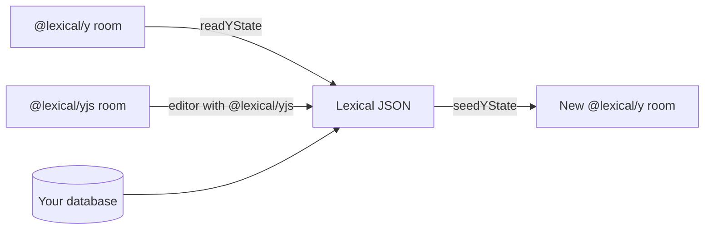

1. **Get the content as Lexical JSON.** If your database holds it, use that.
   If you store only Yjs, read it with the binding that wrote it:
   `readYState` for an `@lexical/y` room, or an editor with `@lexical/yjs`
   for a `@lexical/yjs` room, then `editor.getEditorState().toJSON()`.
2. **Seed the new room** with the same extensions as the clients:

   ```ts
   import {readYState, seedYState} from '@lexical/y/headless';
   import {$getEditor, $getRoot, $parseSerializedNode} from 'lexical';

   const config = {extensions: [AppNodesExtension]};

   // 1. The content as Lexical JSON (here read from an @lexical/y room).
   const json = readYState(oldState, config, () =>
     $getEditor().getEditorState().toJSON(),
   );

   // 2. A new room holding it.
   const seed = seedYState(config, () => {
     for (const child of json.root.children) {
       $getRoot().append($parseSerializedNode(child));
     }
   });
   ```

3. **Switch clients to the new room.** Store `seed` under a new room name,
   point upgraded clients at it, and retire the old room. A client that
   still holds the old room (an open tab, an offline cache) must drop it:
   merging the old room into the new one would mix the two.

### Moving from `@lexical/yjs`

`@lexical/y` writes a different root, and `initialize()` refuses a document
whose `@lexical/yjs` roots hold content, so an old document is never shown
as empty or overwritten. Keep existing documents on `@lexical/yjs` and start
new ones on `@lexical/y`, or reseed them as above. Because the seed holds
only the `@lexical/y` root, a `@lexical/yjs` document can also keep its name:
merge the seed into the stored document next to the old roots (see
[Converting a `@lexical/yjs` document](./y-server.md#converting-a-lexicalyjs-document)).
Either way, upgrade every client of the document at once: edits old clients
make stay in the old root.

## API reference

[`@lexical/y`](/docs/api/modules/lexical_y) ·
[`@lexical/y/headless`](/docs/api/modules/lexical_y/headless)
