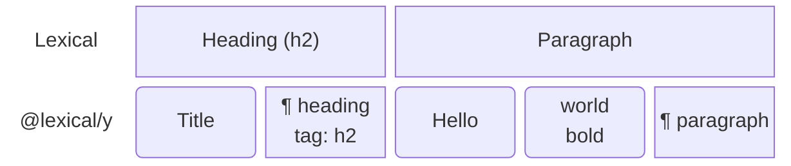
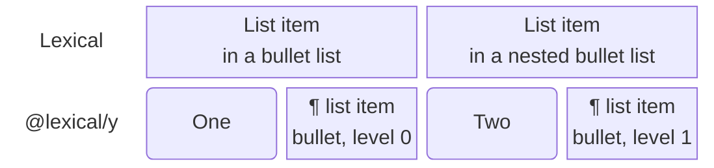
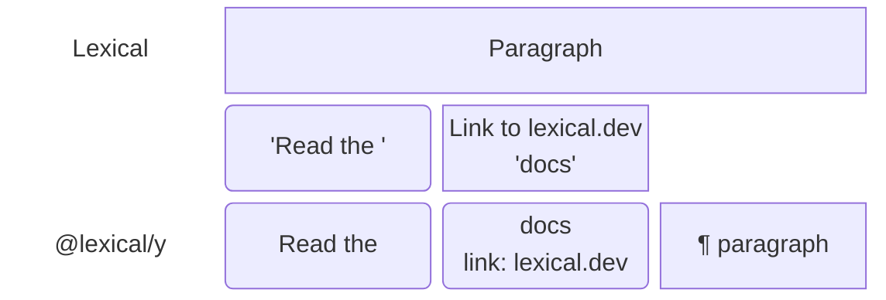
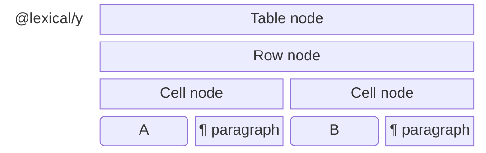
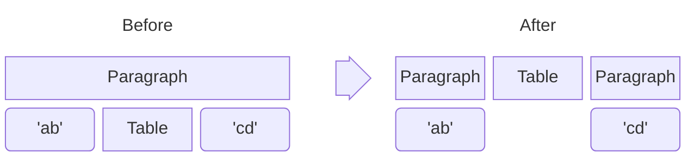
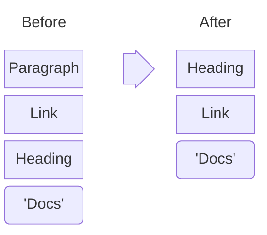
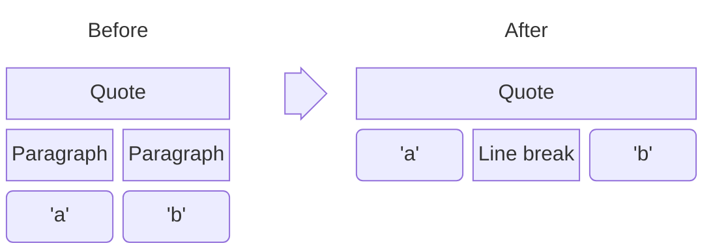
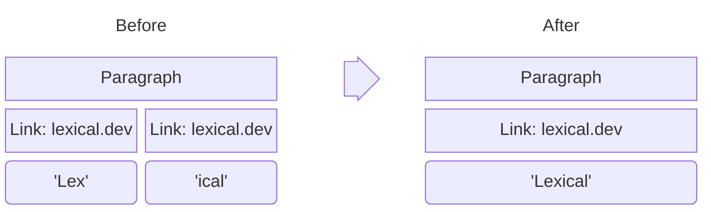

# Yjs 14 (`@lexical/y`)

:::warning Experimental

`@lexical/y` is experimental: every export is marked `@experimental`, and
`@y/y` (Yjs 14) is itself a release candidate. Pin both versions. The
document layout carries a version, so a client that meets a newer layout
opens the document read only instead of misreading it.

:::

`@lexical/y` is a collaboration binding for Lexical on Yjs 14 (the `@y/y`
package). It is separate from `@lexical/yjs`, the Yjs 13 binding that the
[React guide](./react.md) uses: the two use different Yjs libraries and
different document layouts, and a document uses one or the other.

## When to use it

Use `@lexical/y` for a **new** collaborative editor that can run Yjs 14 on
every client and on its server:

- **Concurrent edits keep each other's text.** A paragraph, heading or list
  item is stored as its characters followed by a marker, and a link as a
  format over the characters it wraps. Splitting or joining a paragraph,
  changing its type, indenting a list item, or linking text keeps the
  characters, so what a collaborator types at the same time is not lost.
- **Smaller documents.** Enter, Backspace, heading and list changes write
  only a marker or its attributes.
- **No React or DOM requirement.** The binding is a Lexical extension, so it
  works with any framework and in a headless editor.

Stay on `@lexical/yjs` when you have documents stored in its layouts (see
[Upgrading](#upgrading-from-lexicalyjs)), when your server or other clients
cannot move to Yjs 14, or when you need the `LexicalCollaborationPlugin`
React API.

## Install

```bash
npm i @lexical/y @lexical/extension lexical @y/y@14.0.0-rc.29
```

`@y/y` is a peer dependency pinned to the release candidate `@lexical/y` is
tested with; npm's `latest` tag points at an older one, so name the version.
The type declarations `@y/y` ships do not type-check on their own (an
upstream issue): if you run `tsc`, set `skipLibCheck: true`.

## Set up an editor

`YCollabExtension` connects an editor to a Yjs document. It also provides
collaborative undo (`UNDO_COMMAND` and `REDO_COMMAND` undo only this
client's changes), so leave out `HistoryExtension`: the two conflict. Any
Yjs 14 provider can carry the document; this example uses `@y/websocket`.

```ts
import {
  buildEditorFromExtensions,
  getExtensionDependencyFromEditor,
} from '@lexical/extension';
import {ListExtension} from '@lexical/list';
import {RichTextExtension} from '@lexical/rich-text';
import {YCollabExtension} from '@lexical/y';
import {WebsocketProvider} from '@y/websocket';
import * as Y from '@y/y';
import {configExtension, defineExtension} from 'lexical';

const doc = new Y.Doc();

const editor = buildEditorFromExtensions(
  defineExtension({
    dependencies: [
      RichTextExtension,
      ListExtension,
      configExtension(YCollabExtension, {doc}),
    ],
    name: 'my-app/editor',
  }),
);
editor.setRootElement(document.getElementById('editor'));

const {binding, status} = getExtensionDependencyFromEditor(
  editor,
  YCollabExtension,
).output;

const provider = new WebsocketProvider('wss://example.com', 'my-room', doc);
provider.once('sync', () => {
  // Writes the editor's content if the document is new; otherwise the
  // editor shows the shared content.
  binding.initialize();
});
```

- The editor stays **read only** until the document's layout record has
  been read. `status` is a signal: `'pending'`, then `'active'`, or
  `'readonly'` when the binding cannot write the document safely (a newer
  layout, a node type this editor does not register; a
  [warning](#warnings) says why).
  Register the same node classes on every client.
- `binding.initialize()`, called after the provider's first sync, writes the
  editor's content into an empty document. Two clients that initialize the
  same content at once write it once. It does nothing on a document that
  already has content, and it refuses a document whose `@lexical/yjs` roots
  hold content.
- Pass `synced: true` instead when the document is already loaded (a test,
  an editor bound to a stored state): the extension initializes as soon as
  it registers.

| Option | Default | |
| -- | -- | -- |
| `doc` | (required) | The Yjs document. |
| `root` | `doc.get('lexical-y')` | The shared root to bind. |
| `synced` | `false` | Initialize as soon as the extension registers. |
| `captureTimeout` | `500` | Undo capture timeout in ms; `null` turns collaborative undo off. |
| `clientIDRange` | `'uint53'` | `'uint32'` for servers on yrs before 0.28, see [Servers](#servers). |
| `selfCheck` | `false` | Reads every local write (and every container a remote change rebuilt) back from Yjs and compares it with the editor; a mismatch is a `'@lexical/y/self-check'` [warning](#warnings). A debugging aid: turn it on in tests and development builds. |
| `selfCheckSample` | `1` | The fraction of local writes the self-check reads back. |
| `convert` | `false` | Initialize even when a `@lexical/yjs` root has content. |

Without the extension API, `new YBinding(editor, doc, options)` does the
same: call `binding.start()` to connect it, `binding.initialize()` after the
first sync, and `binding.undo()` / `binding.redo()` for undo.
`binding.getCursor()` and `binding.$resolveCursor()` convert the selection
to and from Yjs relative positions for an awareness-based cursor UI; the
binding does not render remote cursors itself.

### Warnings

The binding reports to the editor's `onWarn` (set it on your root
extension, see [Errors and warnings](/docs/extensions/defining-extensions#errors-and-warnings)).
Each warning is a `LexicalWarning` with a stable `code`, a `message` for
people and `data` for programs. The codes are exported as constants from
`@lexical/y`:

| `code` | Constant | Reported when | `data` |
| -- | -- | -- | -- |
| `'@lexical/y/unsupported-layout'` | `UNSUPPORTED_LAYOUT_WARNING` | The document's layout version is newer than this version, missing or malformed, or a `@lexical/yjs` root has content. The binding is read only. | `{layout, legacyRoots}` |
| `'@lexical/y/unknown-node-types'` | `UNKNOWN_NODE_TYPES_WARNING` | The document has node types the editor does not register. The binding is read only. | `{types}` |
| `'@lexical/y/storage-mismatch'` | `STORAGE_MISMATCH_WARNING` | The document stores a node type in a way this editor's class cannot. The binding is read only. | `{types}` |
| `'@lexical/y/self-check'` | `SELF_CHECK_WARNING` | The self-check (`selfCheck`) found the editor and the document disagree. | `{problems, remote}` |
| `'@lexical/y/recovered-read'` | `RECOVERED_READ_WARNING` | A remote change could not be read; the editor was rebuilt from the document. | `{error}` |
| `'@lexical/y/recovered-write'` | `RECOVERED_WRITE_WARNING` | A local change could not be written; the document was rewritten. | `{error}` |
| `'@lexical/y/nested-fallback'` | `NESTED_FALLBACK_WARNING` | A class declares a line, format or group, but something it does prevents that (see [How content is stored](#how-content-is-stored)); it is stored as a node of its own. Once per class and reason. | `{type}` |
| `'@lexical/y/unsynced-value'` | `UNSYNCED_VALUE_WARNING` | A property or NodeState value is not plain JSON, so it is not synchronized. Once per property. | `{property}` |

```ts
import {LexicalWarning} from 'lexical';

defineExtension({
  // ...
  onWarn(error) {
    if (error instanceof LexicalWarning) {
      reportWarning(error.code, error.message, error.data);
    } else {
      console.warn(error);
    }
  },
});
```

- Warnings arrive once a change has been applied in full: never from inside
  a Yjs observer or transaction. A handler that throws does not affect
  syncing; its error is rethrown in a microtask.
- Without a handler, Lexical's default `onWarn` applies: it throws in
  development (each warning shows up as an uncaught error) and calls
  `console.warn` in production.
- Codes are never renamed or reused; new ones may be added, so a `switch`
  over them needs a `default`.

## How content is stored

`@lexical/y` does not copy the Lexical tree node for node. Each container
(the root, a table cell, a collapsible's content) is one Yjs sequence of
characters, `¶` markers and nested nodes. Splitting a paragraph, changing its
type or linking a word then only writes a marker or an attribute, and the
characters a collaborator is typing into stay where they are. Three rules
decide how a node is stored.

**1. A block that holds text is its text followed by a `¶` marker.** The
marker carries the block's type, fields and NodeState; text formats are
attributes of the characters.



_The heading and the paragraph above, as one sequence._

**2. Lists and links have no node of their own.** A list is rebuilt from its
items, whose markers carry the list's type and the item's level, and a link
is an attribute over the characters it wraps.



_A nested list: the second item's marker says level 1._



_A link: the characters carry its URL._

**3. Everything else is a node of its own**, with its fields as attributes:
tables, rows and cells, decorators, custom containers. An element holds its
own sequence.



_A table: the table, its rows and its cells are nodes of their own, and each
cell holds a sequence._

Custom nodes follow the same rules, from the
[node structure](/docs/serialization/#node-structure) their class declares: a
block that declares `children: 'inline'` is stored like a paragraph, an
inline element that declares `inline: true` and `mergeAdjacent` like a link,
and anything else as a node of its own. Properties a class keeps outside its
`$config` schema and NodeState are not synchronized (the binding warns).
`describeStorage(editor)` lists how each node type is stored. The first write
of a type records its kind, so a later client whose class declares something
else keeps the recorded kind or opens read only. The stored names are
specified in the
[package README](https://github.com/facebook/lexical/tree/main/packages/lexical-y#wire-format-layout-1).

## What changes when you turn on collaboration

Because a paragraph, heading or list item is stored as text followed by a
marker, it can only hold inline content: text, line breaks, links and inline
decorators. Stock Lexical does not stop a block from ending up inside one, so
`YCollabExtension` adds
[`NodeStructureExtension`](/docs/serialization/#node-structure), which
rewrites such shapes into ones the binding can store. Every peer makes the
same rewrite, once, and it only moves content: nothing is deleted. In the
diagrams below, a box holds the boxes under it.

**A block inside a paragraph is split around**, so the block keeps its type.
The same holds for a heading, code block, nested quote or table inside a
quote or list item.



**A heading inside a link becomes a heading holding the link.**



**Paragraphs inside a quote become lines of one quote**, joined by line
breaks, as markdown's `> a` / `>` / `> b` and HTML's `<li><p>a</p><p>b</p></li>`
already import. Paragraphs inside a list item become lines of the item the
same way.



**A block decorator inside a list item splits the list**, as inserting a
horizontal rule into a list item does. In a numbered list, the items after
it keep their numbers: the second list starts where the first one stopped.


**Adjacent equal links merge** (same URL, target, rel and title), and so do
adjacent lists of the same type. Text directly in a table cell is wrapped in
a paragraph.



What this means for your app:

- **Where these shapes come from:** pasted or imported HTML, documents saved
  by an editor without the extension, app code that inserts a block into a
  paragraph, and concurrent edits. They are rewritten when their nodes are
  next updated, or when they arrive from a collaborator.
- **Only editors with the extension are affected.** Editors without
  `@lexical/y` (or `NodeStructureExtension`) keep these shapes. Shadow
  roots, `OverflowNode` and classes that declare nothing are never rewritten.
- **Some content looks different afterwards.** A quote or list item that
  held paragraphs shows them as lines of one quote or item, a heading or
  code block inside a quote is moved out of it, and a list around a
  horizontal rule becomes two lists, numbered as before.
- **To keep blocks inside a container, make it hold blocks.** Declare
  `children: 'block'` on a custom container (a callout that holds
  paragraphs; stray text in it is then wrapped in a paragraph), or use a
  shadow-root quote, `$createQuoteNode({shadowRoot: true})`, which holds
  paragraphs and is left alone.

## Servers

Any Yjs 14 server or relay can host the documents. Clients of
`@lexical/yjs` write to other roots (`root`, `root-v2`), never to
`DEFAULT_ROOT_NAME` (`'lexical-y'`), so they cannot change a `@lexical/y`
document's content and the server needs no check to keep them out.

Servers built on **yrs before 0.28** (y-crdt) read client ids as 32-bit
numbers, while Yjs 14 draws 53-bit ones: an author can receive its own
content back as another client's on reconnect (duplicating it), or lose
offline edits. For such a server, pass `clientIDRange: 'uint32'` on every
client of the document. Give the document a 32-bit client id
before you create the awareness and the provider, because an awareness takes
the document's client id when it is created:

```ts
doc.clientID = crypto.getRandomValues(new Uint32Array(1))[0] || 1;
```

## Limits

Every client converges to the same document, but some concurrent edits do
not merge as a user might expect:

- **Moves.** Moving a block is a delete and a re-insert, so text a
  collaborator types into the moved block at the same time is lost or lands
  at its old position, and two collaborators moving the same block at once
  can duplicate it. Lexical operations that move content (turning a
  paragraph into a list inside a container, indenting list items that hold
  blocks) behave the same way.
- **Delete wins.** Text typed into a container that a collaborator deletes at
  the same time is deleted with it, and so is a block moved into it.
- **Last writer wins** for the fields of one link (URL and target change
  together) and for a field of one paragraph or list item.
- **Mark nodes.** `MarkNode` is an element with its own content, so wrapping
  a range moves the text into it, and concurrent typing in that range stays
  outside.
- **Not synchronized:** named slots, nested editor instances (their JSON
  snapshots are), and properties outside a class's `$config` schema and
  NodeState.
- **Repairs.** Concurrent edits can leave shapes Lexical would normalize (a
  ragged table after a row insert and a column insert, two equal lists side
  by side). Every client repairs them the same way. Text typed into a list
  that is merged away before the merge reaches its author is lost.
  A repair is written as a move, so two clients that repair the same block
  from different states can both apply it and show the block twice.
- **Initial content with random values.** Clients that initialize an empty
  document at once write it once only when their content is identical. An
  extension that gives new blocks random ids makes it differ, so the content
  shows twice. Seed new documents in one place, or give
  the initial blocks fixed ids.
- **Undo** keeps a container whole once another client has put content in
  it. Undoing a removal restores the text as new content: a block a
  collaborator moved out of the removed range at the same time shows twice
  (the original next to the moved copy), and when two
  collaborators remove the same text and both undo, it shows twice.
- **Large lists.** A structural edit in a list costs time proportional to
  the list on every client.

## Upgrading from `@lexical/yjs`

There is no in-place migration. `@lexical/y` uses a different root and
layout, and `initialize()` refuses a document whose `@lexical/yjs` roots
hold content, so an old document is never shown as empty or overwritten.
Start new documents on `@lexical/y` and keep existing ones on
`@lexical/yjs`, choosing the binding per document.
Upgrade every client that opens a document at the same time: edits that old
clients make stay in the old root.

## API reference

[`@lexical/y`](/docs/api/modules/lexical_y)
